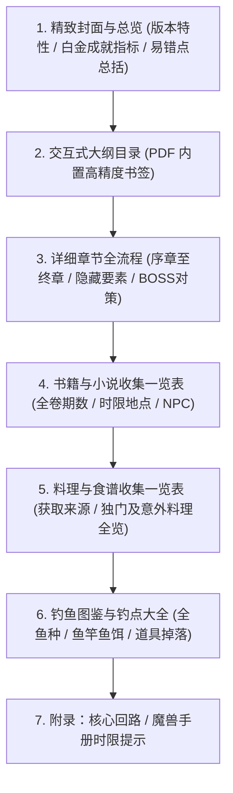

# 轨迹系列 100% 全要素白金攻略 PDF 生成系统设计规范

## 1. 概述与目标

本项目旨在为日本 Falcom 旗下经典角色扮演游戏《轨迹系列》（Trails Series）共 12 部核心作品制作独立的高清全要素全收集 A4 彩色攻略本 PDF。
每部作品均提供一份独立的、结构严谨的、专为平板/大屏阅读优化的白金指南。

### 覆盖作品清单（共 12 部）
1. **《英雄传说 空之轨迹 the 1st》（全新 3D 重制版）**
2. **《英雄传说 空之轨迹 the 2nd》（全新 3D 重制版）**
3. **《英雄传说 零之轨迹》**
4. **《英雄传说 碧之轨迹》**
5. **《英雄传说 闪之轨迹 I》**
6. **《英雄传说 闪之轨迹 II》**
7. **《英雄传说 闪之轨迹 III》**
8. **《英雄传说 闪之轨迹 IV》**
9. **《英雄传说 创之轨迹》**
10. **《英雄传说 黎之轨迹 I》**
11. **《英雄传说 黎之轨迹 II》**
12. **《英雄传说 界之轨迹 -Farewell, O Zemuria-》**

---

## 2. 核心架构与技术栈

### 2.1 渲染引擎（方案 1）
* **核心方案**：HTML5 + CSS3 Paged Media + macOS 原生 Headless Google Chrome。
* **执行命令**：
  ```bash
  /Applications/Google\ Chrome.app/Contents/MacOS/Google\ Chrome \
    --headless=new \
    --disable-gpu \
    --run-all-compositor-stages-before-draw \
    --print-to-pdf-no-header \
    --print-to-pdf="dist/<游戏名称>_100全要素详细攻略.pdf" \
    "build/<游戏名称>.html"
  ```
* **技术优势**：
  * 具备完全的 Web 排版自由度（Flexbox / CSS Grid / 渐变标签 / 自定义装饰器）。
  * 完美生成矢量字体与高保真图表，放大阅读无失真。
  * 原生根据 HTML 语义标题（`<h1>`、`<h2>`、`<h3>`）生成 PDF 目录树书签，支持单机快速跳转。

### 2.2 数据源接入与清洗管道
* **官方/玩家社区权威数据源**：`https://trails-game.com`（轨迹系列 Cafe）与维基数据库。
* **数据清洗模块（Python）**：
  * `fetch_guide.py`：自动解析并结构化提取对应作品的详细流程页面（包含序章至终章、新增任务、BP/DP/AP/SP 加分项、关键选择支）。
  * `fetch_notes.py`：自动提取四大收集数据库：
    1. 书籍笔记（利贝尔通信/帝国时报/泰雷尔通讯、卡佩拉/红月罗赛/黑之史书/赌徒杰克等全卷与时限）。
    2. 料理笔记（大成功、独门、意外料理角色对应表与食谱坐标）。
    3. 钓鱼笔记（鱼种、钓场、鱼饵、鱼竿、掉落道具）。
    4. 核心回路 / 魔兽战斗笔记与宝箱注意点。

---

## 3. PDF 视觉风格与页面布局系统

### 3.1 页面规格与排版标准
* **尺寸**：标准 A4（210mm × 297mm），竖版。
* **页边距**：Top 16mm, Bottom 16mm, Left 14mm, Right 14mm。
* **正文字体**：`-apple-system, BlinkMacSystemFont, "PingFang SC", "Hiragino Sans GB", "Microsoft YaHei", sans-serif`，确保全平台中文字形清晰自然。
* **分页防护规则**：
  * 任务卡片（`.quest-card`）、BOSS 战术板（`.boss-card`）、收集表格行（`tr`）、高亮提示框（`.alert-box`）全部强制声明 `break-inside: avoid;` 与 `page-break-inside: avoid;`，严禁跨页断裂。

### 3.2 游击士终端 UI 视觉色彩规范
* **主品牌色**：导力蓝（`#0e3860`）与利贝尔/帝国金（`#c99a32`）。
* **背景基底**：纯净浅象牙白（`#fbfcfd`），正文深炭灰（`#2c3e50`），保护屏幕长时间阅读视力。
* **标识标签规范**：
  * 🔴 **【时限警告 BADGE】**：红底白字（`background: #d32f2f; color: #fff;`），用于标记一旦错过不可逆的主支线时限、隐藏 AP 对话。
  * 🟢 **【重制版新增/变更 BADGE】**：绿底金边（`background: #1b5e20; border: 1px solid #ffd54f; color: #fff;`），精准标注重制版专属内容。
  * 🟡 **【BP/AP/SP 奖励 BADGE】**：金底黑字（`background: #ffb300; color: #1a1a1a;`），突出标示额外加分选项。
  * 🔵 **【收集品分类 ICON】**：
    * 📖 书籍：`#3949ab`
    * 🍳 料理：`#f57c00`
    * 🎣 钓鱼：`#00897b`
    * 📦 宝箱：`#6d4c41`

---

## 4. 单本攻略的章节模块体系

每一份独立 PDF 必须包含以下六大章节结构：



### 4.1 详细流程攻略的设计粒度
1. **章节起始面板**：该章节可获得的最高 BP/DP/AP、可收集书籍一览、新增料理与钓点总览。
2. **按时间轴推进的步骤卡**：
   * 明确指引每一步的目标地点与交互人物。
   * **任务类型清晰标注**：【主线】、【常规支线】、【隐藏任务】、【重制版新增任务】。
   * **分支选择支**：明确指出所有选项的效果，并用金色高亮标注“最佳获得 AP/BP”选项。
3. **BOSS / 强敌战术框**：
   * BOSS 属性有效率（地、水、火、风、时、空、幻）。
   * 状态异常与能力降低耐性。
   * 推荐阵型、核心回路、关键魔法与驱散/破防要点。

### 4.2 收集分表格式规范
* **书籍列表**：书名 | 卷数/期数 | 获得章节 | 获得地点/NPC | 错过说明。
* **料理列表**：食谱名 | 获取章节与地点 | 独门料理（角色/料理名）| 意外料理（角色/料理名）| 效果。
* **钓鱼列表**：编号 | 鱼名 | 推荐钓竿 | 推荐鱼饵 | 出现钓点 | 掉落耀晶石/道具。

---

## 5. 分阶段实施策略与交付步骤

1. **第一阶段：标杆工程（《空之轨迹 the 1st 重制版》）**
   * 编写数据提取与格式化生成脚本。
   * 构建 HTML 模板与 JRPG 专用打印 CSS。
   * 渲染生成《空之轨迹 the 1st 重制版 100%全要素白金攻略.pdf》。
   * 检查 PDF 分页、目录树、表格美观度与内容详尽度。
   * 交付用户验收。
2. **第二阶段：批次化自动化交付（其余 11 作）**
   * 空轨 2nd 重制版。
   * 克洛斯贝尔篇（零轨、碧轨）。
   * 埃雷波尼亚帝国篇（闪轨 1-4、创轨）。
   * 卡尔瓦德共和国篇（黎轨 1-2、界轨）。

---

## 6. 自检与质量标准（Definition of Done）
- [x] 所有 12 部作品均有明确独立输出目标。
- [x] 明确区分原版与重制版新增支线及改动。
- [x] 每一个收集要素（书籍/料理/钓鱼/时限BP）均有系统化独立表格。
- [x] PDF 渲染无断页截字、目录书签完整、矢量字形高清。
